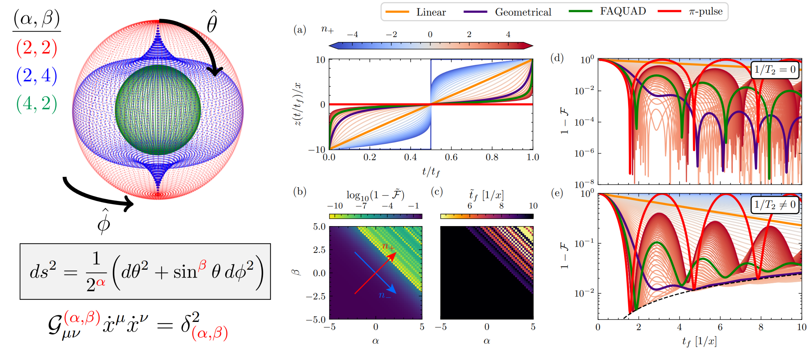

[](https://doi.org/10.5281/zenodo.15173706)

# Unifying adiabatic state-transfer protocols with (α, β)-hypergeometries

_Authors: Christian Ventura Meinersen, David Fernandez-Fernandez, Gloria Platero, Maximilian Rimbach-Russ_

Codes to reproduce the figures in the article: Unifying adiabatic state-transfer protocols with (α, β)-hypergeometries.
All notebooks start with a small introduction of the relevant equations and concepts.
The final figures, after a post process in some cases, can be found in the [pictures](https://github.com/Davtax/Alpha-beta-hypergeo/tree/main/pictures) folder, in a `.pdf` format.

<p align="center">
  
</p>

## Figures

The notebooks are named after the figure numbers of the revised manuscript. Fig. 1 is a schematic picture, and has no associated notebook.

| Figure | Notebook | Content |
| :------: | ---------- | --------- |
| 2 | [Fig02-LZ](Fig02-LZ.ipynb) | Landau-Zener pulses, minimum infidelity and optimal pulse time vs. $(\alpha, \beta)$, and infidelity vs. pulse time with and without dephasing |
| 3 | [Fig03-resonances](Fig03-resonances.ipynb) | Resonances and adiabatic envelope of the infidelity |
| 4 | [Fig04-quasistatic_noise](Fig04-quasistatic_noise.ipynb) | Quasi-static noise |
| 5 | [Fig05-noise_susceptibility](Fig05-noise_susceptibility.ipynb) | Filter functions and noise susceptibility for $1/f$ noise |
| 6 | [Fig06-function_approximation](Fig06-function_approximation.ipynb) | Basis of Landau-Zener pulses, approximation of a cubic pulse, and reconstruction error for a $\Lambda$-system |
| 7 | [Fig07-filtered_pulses](Fig07-filtered_pulses.ipynb) | Filtered pulse (Butterworth filter) |
| 8 | [Fig08-optimal_nplus](Fig08-optimal_nplus.ipynb) | Filtered pulses with dephasing, and optimal $n_+$ vs. cut-off frequency |
| 9 | [Fig09-pulse_properties](Fig09-pulse_properties.ipynb) | Slew rate and bandwidth |
| 10 | [Fig10-runtime](Fig10-runtime.ipynb) | Runtime for the pulse generation |
| 11 | [Fig11-shuttling_model](Fig11-shuttling_model.ipynb) | Shuttling model with two valleys per dot |
| 12 | [Fig12-CRAB_GRAPE_pulses](Fig12-CRAB_GRAPE_pulses.ipynb) | Comparison with CRAB and GRAPE: pulses and Fourier transform |
| 13 | [Fig13-CRAB_GRAPE_filtered](Fig13-CRAB_GRAPE_filtered.ipynb) | Comparison with CRAB and GRAPE: filtered pulses |
| 14 | [Fig14-CRAB_GRAPE_runtime](Fig14-CRAB_GRAPE_runtime.ipynb) | Comparison with CRAB and GRAPE: runtime |
| 15 | [Fig15-time_adiabatic](Fig15-time_adiabatic.ipynb) | Pulse time needed to reach the adiabatic regime |
| 16 | [Fig16-rank](Fig16-rank.ipynb) | Rank of the Gram matrix of the basis |
| 17 | [Fig17-optimal_nplus_2](Fig17-optimal_nplus_2.ipynb) | Optimal filtered pulses vs. dephasing time and boundary conditions |
| 18 | [Fig18-error_shuttling_model](Fig18-error_shuttling_model.ipynb) | Reconstruction error for the shuttling model (split basis) |
| 19 | [Fig19-fidelity_error](Fig19-fidelity_error.ipynb) | Transfer fidelity vs. reconstruction error |
| 20 | [Fig20-miscalibration](Fig20-miscalibration.ipynb) | Robustness of the shuttling pulses against a miscalibrated Hamiltonian |

## Dependences

The dependences are listed in [pyproject.toml](pyproject.toml), and the exact versions used to run the notebooks are pinned in [uv.lock](uv.lock). With [uv](https://docs.astral.sh/uv/), the environment (Python 3.9) is created with

```bash
uv sync
```

which also installs `ipykernel` and `ipywidgets` (to show the progress bars inside the notebooks). Alternatively, the packages can be installed with pip:

```bash
pip install numpy
pip install scipy
pip install matplotlib
pip install parameterrun  # Parallel parameter sweeps (https://github.com/Davtax/ParameterRun)
pip install tqdm
pip install qutip  # QuTiP 5
pip install qutip-qtrl  # Only needed for the comparison with CRAB and GRAPE (Figs. 12-14)
pip install colorstamps
pip install brokenaxes
```

Optionally, `ipywidgets` can be installed to show the progress bars inside the notebooks.

The code is formatted and linted with [ruff](https://docs.astral.sh/ruff/), and type-checked with [ty](https://docs.astral.sh/ty/) (`ruff check .`, `ruff format .`, and `ty check`).

## Usage

All notebooks are self-contained except for the functions defined inside the [HQUAD-lib](https://github.com/Davtax/Alpha-beta-hypergeo/tree/main/HQUAD_lib) module. Just execute all the cells in order, and the figure will be shown at the end of the notebook.
To speed up the execution of the notebooks, the resolution of the data is lower than the figures shown in the final article.
Comments have been included in those lines in which the resolution is defined.
Unless stated otherwise in the notebook, energies are given in units of the relevant coupling of each model ($x$ for the Landau-Zener problem, $t_c$ for the shuttling model), and times in units of $\hbar/x$ (or $\hbar/t_c$).
